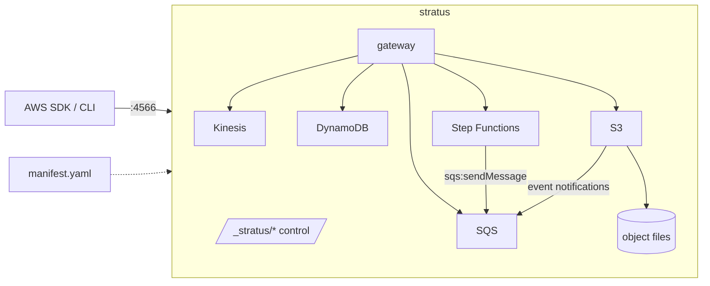

# How stratus works

stratus is one Go process. It emulates five AWS services behind one HTTP port, keeps their state in
memory, and keeps S3 object bytes in files.

## One port, routed by the request

The gateway picks a service for each request:

1. **`X-Amz-Target`.** The JSON protocols (SQS, Kinesis, DynamoDB, Step Functions) name their
   operation in this header, with a prefix per service, such as `DynamoDB_20120810.PutItem`.
2. **The SigV4 credential scope.** A request without a target, such as SQS's query protocol,
   still names its service in `Authorization: AWS4-HMAC-SHA256 Credential=…/sqs/aws4_request`.
3. **S3**, for everything else: a REST request with a bucket and key in the path or the host.

The signature is read for its scope only and never verified. Any credentials work, including a
placeholder typed by hand into a test tool.

## Services in memory

Each service is a Go package under `internal/<service>` with its own state and locks. An
operation, and a DynamoDB transaction as a whole, runs under the service's lock, so each is
atomic. There is no database and no external process: DynamoDB's expression language, the Kinesis
hash ranges and the Amazon States Language interpreter are implemented in Go.

That is why stratus starts in milliseconds and needs a few MiB of memory. It is also why an
operation that is not implemented answers with an error that names it, instead of behaving
almost right.

## S3 bytes on disk

S3 keeps each object's bytes in a file, so a large object does not hold memory. A file is written
once and never changed. It is removed when nothing refers to it any more: no version, no copy
sharing it, and no reader that took it before a delete. Without `-state-dir` the directory is
removed on exit. stratus never uses `/tmp`, which is a tmpfs held in memory on many systems.

## Declared resources

The manifest is applied before stratus answers `ready`. A `docker compose` health check or a
Testcontainers wait strategy therefore means "every resource exists", and nothing has to poll for
a table or a queue. An unknown key stops the start: a misspelt `visibilityTimout` would otherwise
silently create a queue with the default.

## Services that talk to each other

Two AWS integrations are emulated inside the process:

- **S3 event notifications** put an event message on an SQS queue, filtered by event type, prefix
  and suffix, in the format S3 uses.
- **Step Functions `sqs:sendMessage`** tasks send to a queue of the same emulator.

## Deterministic time

Nothing time-driven happens on its own unless asked for, so a test sees exactly what it wrote:

| Behaviour | When it happens |
|---|---|
| DynamoDB TTL | every `-ttl-interval`, or on `POST /_stratus/expire-ttl` |
| S3 lifecycle expiry, Kinesis retention trimming | when a test asks through the Go API |
| SQS retention | when the queue is next used, as in SQS |
| Visibility timeouts, delays, `Wait` states, iterator expiry | at the moment they are due |

Inside the packages a clock is injected, so the tests of stratus itself move time by hand.

## The web panel

The panel at `/_stratus/ui` is server-rendered HTML with [htmx](https://htmx.org), embedded in
the binary. Its changes go through the same AWS API a client uses, so they are validated and
have their usual effects.
