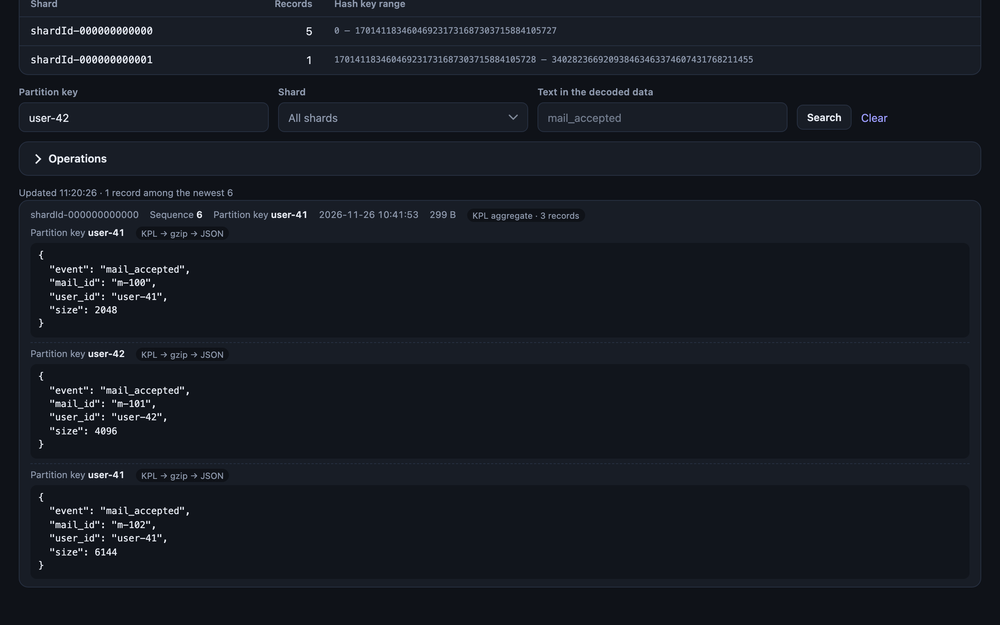
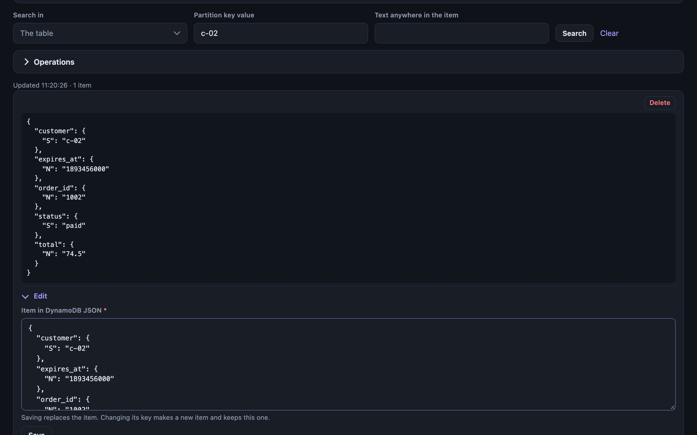

# Web panel

Open [http://localhost:4566/_stratus/ui](http://localhost:4566/_stratus/ui).

The overview shows a card per queue, stream, bucket, table and state machine, with its counts,
refreshed every 2 seconds. You can create resources of each kind from it. **Reset** returns to the
manifest's state, and **Expire TTL** deletes expired DynamoDB items.

## A resource's page

A resource's name opens its page. It shows the resource's settings, a search suited to the service,
its operations and its data, refreshed every 3 seconds (but not while you edit).

| Resource | Settings | Search | Change |
|---|---|---|---|
| Queue | attributes, dead-letter queue and its sources | text in bodies and attributes | send; edit (a new message replaces the old: SQS cannot change one); delete; purge; redrive a DLQ to its source |
| Stream | ARN, mode, retention, shards with hash ranges and record counts | partition key, shard, text in the decoded data | put a record (records cannot be changed or deleted) |
| Bucket | versioning, lifecycle rules, notifications | key prefix and text | upload a file or store text; edit a text object; delete; empty |
| Table | key schema, indexes, TTL, item count and size | partition key value, in the table or an index; text | put, edit and delete items as DynamoDB JSON |
| State machine | ARN, type, role, definition | execution status and name | start an execution; stop a running one |

Every resource can also be deleted from its page. Changes go through the emulator's own AWS API,
so they are validated and have their usual effects, such as S3 notifications to queues.

## Decoded data

A Kinesis record aggregated by the Kinesis Producer Library is split into its user records, each
with its partition key. gzip and zlib payloads are decompressed (up to 1 MiB), and JSON is
indented, so a record reads `KPL → gzip → JSON`. A search by partition key finds an aggregate by
the keys inside it. zstd is recognised but not decompressed. S3 objects, SQS bodies and execution
input and output are decoded the same way.

| A Kinesis record aggregated by the KPL | A DynamoDB item, edited in place |
|---|---|
|  |  |

## Security

The panel is part of the binary. It is server-rendered with [htmx](https://htmx.org), embedded, and
needs no network. Like the rest of the endpoint it has no login: anyone who can reach the port can
use it. Its changes accept only requests sent by the panel itself (the `HX-Request` header), so a
page on another site cannot make them in a browser that has the panel open. Downloads are sent as
attachments, so an uploaded HTML page never runs in the panel.

!!! danger
    Do not expose stratus on a network you do not trust. It is a development tool and has no
    authentication.
