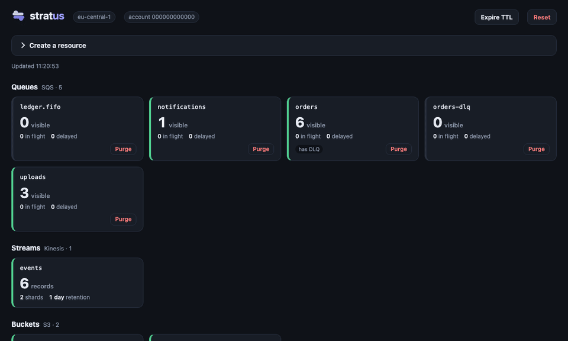

---
hide:
  - toc
---

# stratus

A local emulator of **SQS, S3, DynamoDB, Kinesis and Step Functions** for development and
end-to-end tests: one static Go binary, ready in milliseconds, with the resources you declare in
a manifest.

```sh
docker run --rm -p 4566:4566 stratusemulator/stratus
```

<div class="stratus-cards" markdown>

<a class="stratus-card" href="getting-started/">
  <span class="name">getting-started</span>
  <span class="count">5<small>minutes</small></span>
  <span class="meta">manifest · run · use · look inside · start over</span>
</a>

<div class="stratus-card" markdown>
<span class="name">guides</span>
<span class="count">6<small>guides</small></span>

- [Docker and Compose](guides/docker.md)
- [Go tests](guides/go-tests.md)
- [Testcontainers](guides/testcontainers.md)
- [Keeping data across restarts](guides/persistence.md)
- [Moving from LocalStack](guides/from-localstack.md)
- [Web panel](guides/web-panel.md)
</div>

<div class="stratus-card" markdown>
<span class="name">reference</span>
<span class="count">5<small>pages</small></span>

- [Manifest](reference/manifest.md)
- [Command line](reference/cli.md)
- [Control endpoints](reference/endpoints.md)
- [Services and operations](reference/services.md)
- [Go packages](reference/go.md)
</div>

<div class="stratus-card" markdown>
<span class="name">explanation</span>
<span class="count">3<small>pages</small></span>

- [How stratus works](explanation/architecture.md)
- [How state is kept](explanation/state.md)
- [Compared with LocalStack](explanation/localstack.md)
</div>

<div class="stratus-card" markdown>
<span class="name">contributing</span>
<span class="count">3<small>pages</small></span>

- [Build and test](contributing/index.md)
- [Adding an operation](contributing/adding-an-operation.md)
- [Releases](contributing/releases.md)
</div>

</div>

## Services

<div class="stratus-cards" markdown>

<a class="stratus-card" href="reference/services/#sqs">
  <span class="name">sqs</span>
  <span class="count">18<small>operations</small></span>
  <span class="meta">standard · FIFO · DLQ · long polling</span>
</a>

<a class="stratus-card" href="reference/services/#kinesis">
  <span class="name">kinesis</span>
  <span class="count">15<small>operations</small></span>
  <span class="meta">shards · every iterator · checkpoints</span>
</a>

<a class="stratus-card" href="reference/services/#s3">
  <span class="name">s3</span>
  <span class="count">28<small>operations</small></span>
  <span class="meta">versioning · multipart · checksums · events</span>
</a>

<a class="stratus-card" href="reference/services/#dynamodb">
  <span class="name">dynamodb</span>
  <span class="count">16<small>operations</small></span>
  <span class="meta">expressions · indexes · transactions · TTL</span>
</a>

<a class="stratus-card" href="reference/services/#step-functions">
  <span class="name">step functions</span>
  <span class="count">13<small>operations</small></span>
  <span class="meta">Wait · Choice · Retry/Catch · task tokens</span>
</a>

</div>

## Why stratus

| | |
|---|---|
| **One port, any credentials** | every service on `:4566`; signatures are never checked |
| **Declared, not scripted** | a [manifest](reference/manifest.md) lists what exists; ready means it all exists |
| **Built for tests** | `POST /_stratus/reset` between suites; [in-process](guides/go-tests.md) or [in a container](guides/testcontainers.md) |
| **Keeps data when you want** | `-state-dir` keeps all five services across restarts, [per resource](guides/persistence.md) |
| **A panel to look inside** | `/_stratus/ui` shows, searches and edits every resource; KPL records decoded |

## How fast

Both in Docker with 1 CPU and 2 GB, from the same 63-resource manifest
([method and full results](explanation/localstack.md)):

| | LocalStack | stratus |
|---|---|---|
| Ready | 13.7 s | **0.24 s** |
| Memory once ready | 636 MiB | **3 MiB** |
| Image | 1.81 GB | **12.9 MB** |
| SQS SendMessage, 32 clients | 883 ops/s | **13 058 ops/s** |
| Kinesis PutRecord, 32 clients | 64 ops/s | **13 580 ops/s** |


